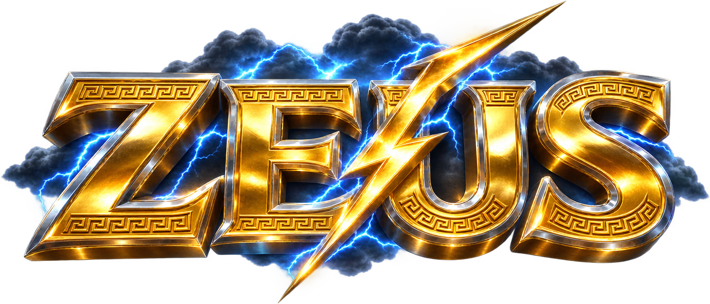
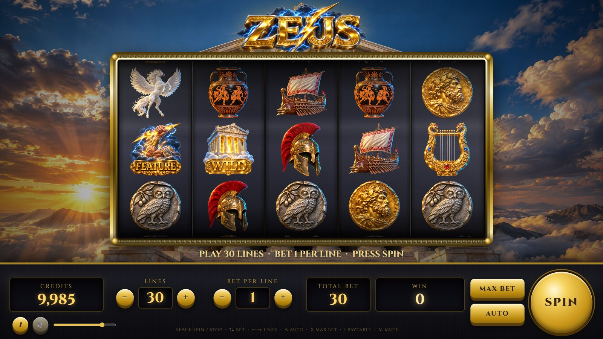
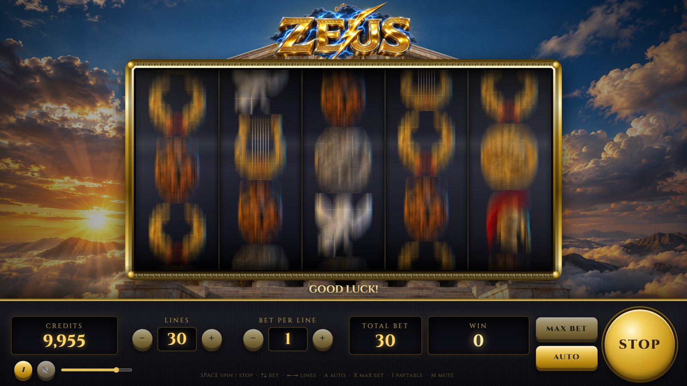
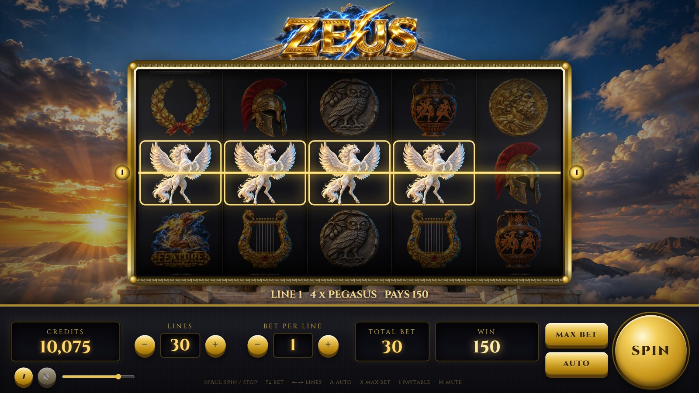
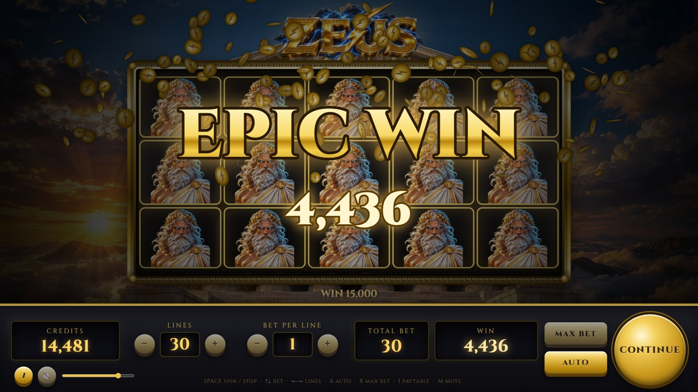
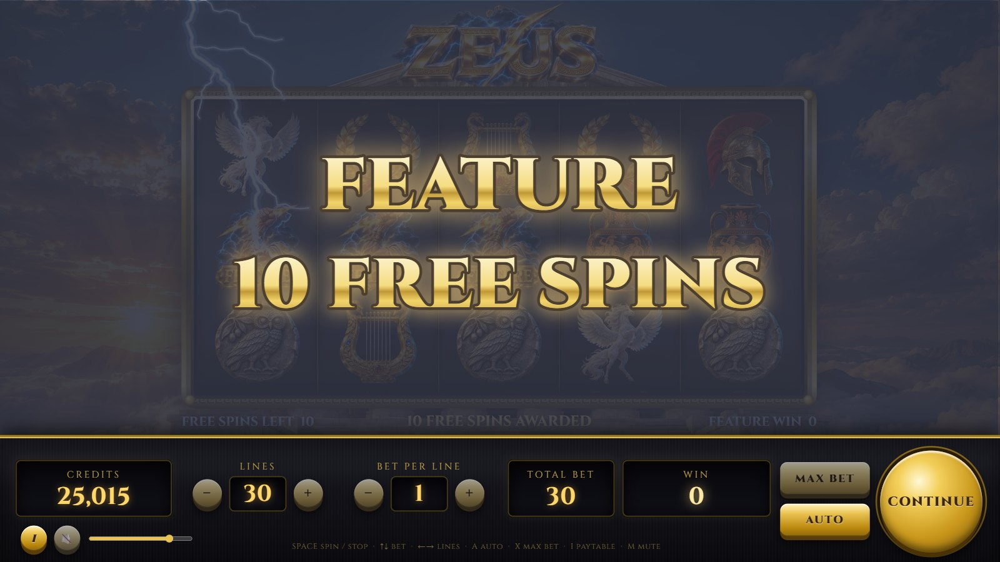
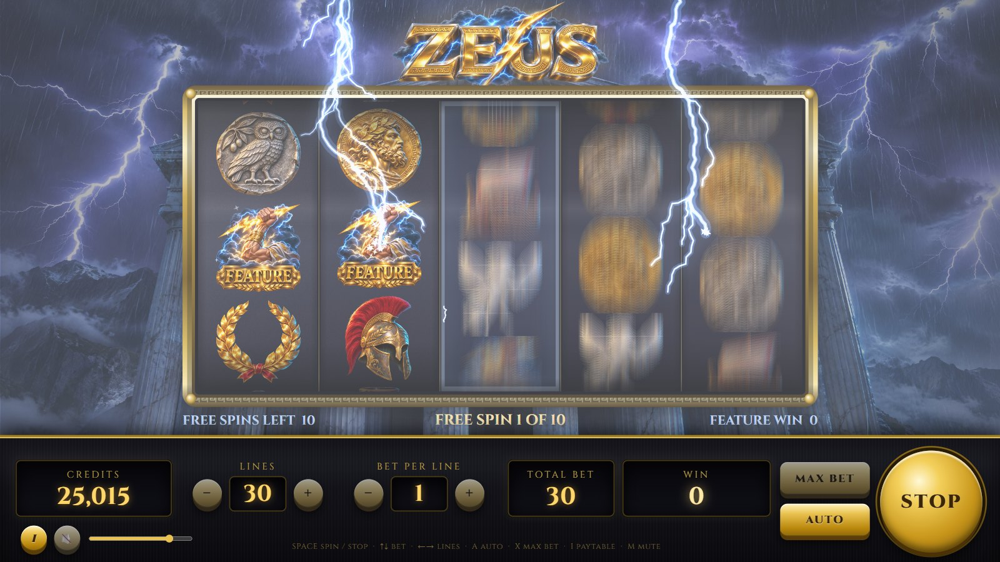
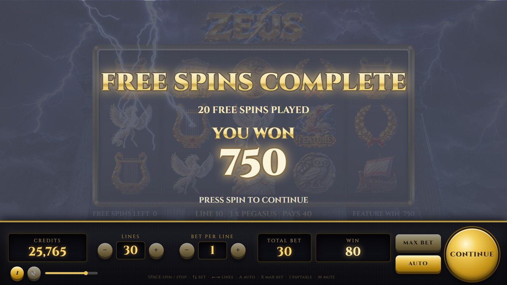
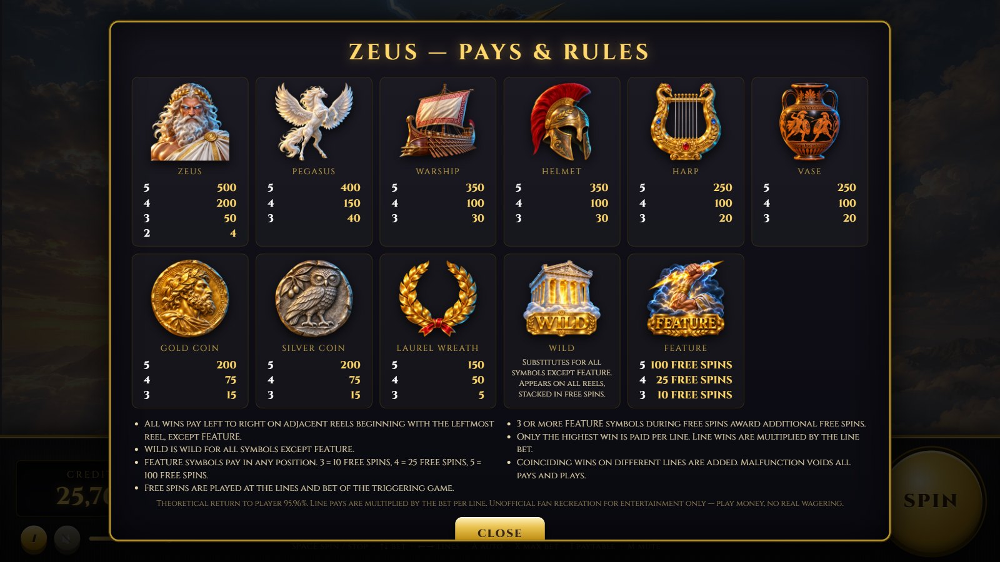

<div align="center">



### A photorealistic, physics-driven, fully sounded web recreation of the classic *Zeus* slot machine


</div>

Plain HTML5 Canvas, Web Audio and vanilla JavaScript. No frameworks, no build
step, no server-side code: it runs from any static host or straight from disk.
The reel strips reproduce the original paytable and return **95.96 %** in theory
(69.1 % base game + 26.9 % free spins); the feature lands about once every 101
spins. Everything you hear is synthesized live, and every piece of art was
generated for this project.

> Unofficial fan recreation for entertainment only. Zeus is a trademark of its
> owner. Play money, no real wagering.

---

## Contents

1. [Features](#features)
2. [Platforms](#platforms)
3. [Installation](#installation)
4. [Configuration reference](#configuration-reference)
5. [User guide](#user-guide)
6. [Keyboard shortcuts](#keyboard-shortcuts)
7. [Known limitations](#known-limitations)
8. [Project layout](#project-layout)
9. [Development](#development)

---

## Features

**Game**

* 5 reels × 3 rows, 1–30 selectable paylines, bet per line 1 / 2 / 3 / 5 / 10 / 20
* Original pays (× line bet): Zeus 500 / 200 / 50 / 4 · Pegasus 400 / 150 / 40 ·
  Warship 350 / 100 / 30 · Helmet 350 / 100 / 30 · Harp 250 / 100 / 20 ·
  Vase 250 / 100 / 20 · Gold Coin 200 / 75 / 15 · Silver Coin 200 / 75 / 15 ·
  Laurel Wreath 150 / 50 / 5
* Temple **WILD** substitutes for every symbol except **FEATURE**
* 3 / 4 / 5 **FEATURE** symbols anywhere award 10 / 25 / 100 free spins on a second,
  storm-lit reel set with stacked Zeus and stacked Wilds; free spins retrigger
* Stacked Zeus on every reel: a full screen of Zeus pays 500 × the total bet
* Big / Mega / Epic win celebrations at 15× / 50× / 100× the bet
* Autoplay, max bet, slam-stop, paytable and rules screens

**Reel physics**

* Pull-back wind-up, acceleration to 27 symbols per second, blurred full-speed spin
* Constant deceleration onto the stop, overshoot and a damped-spring bounce
  (ω = 22 rad/s, ζ = 0.42) — the classic mechanical "snap back"
* Anticipation: once two FEATURE symbols have landed, the remaining reels spin on
  with a rising drone, heartbeat thumps and a crackling blue glow
* Outcomes come from weighted reel strips drawn with the Web Crypto RNG, spliced
  into the spinning strip while it is a blur — exactly what the maths assumes

**Rendering**

* 1920 × 1080 virtual scene scaled to any window, crisp on high-DPI displays
* Cylindrical drum projection with per-slice compression, speed-dependent motion
  blur, drum lighting, glass reflections, metal bezel with Greek meander
* Winning symbols pulse, shimmer and crackle; paylines sweep with numbered badges;
  procedural fractal lightning, screen flash, camera shake and coin showers
* Photoreal symbol, logo and background art; the sky turns to a thunderstorm
  for free spins

**Sound (all synthesized in Web Audio, no audio files)**

* Reel whir that follows speed, symbol ticks, mechanical stop thuds
* Thunder and lightning zaps, harp plucks (Karplus–Strong), bells, brass fanfares,
  timpani, coin clinks, roll-up counters with rising pitch
* An ambient Olympus music bed and a driving free-spins bed, ducked under wins
* Volume slider and mute, remembered between sessions

---

## Platforms

| Platform | Status | Notes |
| --- | --- | --- |
| Chrome / Edge (desktop) | Tested | Development browsers; screenshots are taken with headless Chrome |
| Firefox (desktop) | Expected to work | Standard Canvas 2D and Web Audio only |
| Safari (macOS / iOS) | Expected to work | Audio starts after the first tap, as on every platform |
| Android / iOS browsers | Playable | The scene scales to the screen; landscape recommended |
| Offline / `file://` | Works | Open `index.html` directly; the display font falls back to a system serif without network |

Requirements: any browser with Canvas 2D, Web Audio and ES2020 (2020 or newer).
Node.js 22+ is only needed for the optional RTP and screenshot tools.

---

## Installation

1. **Get the files.** Download or clone this folder. Keep `assets/`, `css/` and
   `js/` next to `index.html`.
2. **Serve it (recommended).** Any static server will do:

   ```bash
   python -m http.server 8765
   ```

   On Windows you can double-click `start.cmd`, which starts that server and
   opens the game. Then browse to <http://localhost:8765/>.
3. **Or open it from disk.** Double-click `index.html`. Chrome and Edge run the
   game from `file://` because it never reads pixels back from the images.
4. **Click once** on the splash screen to unlock audio, then press **SPIN**.
5. **Optional URL parameters:** `?mute=1` starts silent; see
   [Development](#development) for the outcome-forcing test parameters.

### Configuration reference

All tuning lives in plain JavaScript constants — edit, save, reload.

| Setting | File | Default | Meaning |
| --- | --- | --- | --- |
| `startCredits` | `js/config.js` | `10000` | Play credits on load |
| `lineOptions` | `js/config.js` | `1, 5, 10, 15, 20, 25, 30` | Selectable payline counts |
| `betOptions` | `js/config.js` | `1, 2, 3, 5, 10, 20` | Bet per line steps |
| `SYMBOLS[].pays` | `js/config.js` | original Zeus pays | Line pays per symbol for 2–5 of a kind |
| `FEATURE.freeSpins` | `js/config.js` | `3: 10, 4: 25, 5: 100` | Free spins per scatter count |
| `PAYLINES` | `js/config.js` | 30 patterns | Row index per reel (0 top, 1 middle, 2 bottom) |
| `BASE_COUNTS` / `FREE_COUNTS` | `js/config.js` | tuned to 95.96 % | Symbols per reel strip; `*_STACKS` sets stack heights |
| `vmax`, `accelTime` | `js/reel.js` | `27`, `0.45` | Spin speed (symbols/s) and acceleration time (s) |
| `overshoot`, `omega`, `zeta` | `js/reel.js` | `0.26`, `22`, `0.42` | Stop bounce: overshoot (symbols), spring frequency, damping |
| `first`, `gap` (in `spin()`) | `js/game.js` | `1.1`, `0.33` | Seconds until the first reel stops, spacing between reel stops |
| anticipation extra (in `spin()`) | `js/game.js` | `1.7` | Extra seconds per reel while anticipating a third scatter |
| big-win tiers (in `presentWins()`) | `js/game.js` | `15×, 50×, 100×` | Thresholds for BIG / MEGA / EPIC celebrations |
| `REEL` layout | `js/renderer.js` | `232 × 186` cells | Reel window geometry in the 1920 × 1080 scene |
| `zeus.volume`, `zeus.muted` | browser `localStorage` | `0.8`, `0` | Remembered volume and mute state |

Changing strip counts changes the return to player. Run `node tools/rtp-sim.js`
afterwards; it prints the exact RTP, the trigger rate and a Monte-Carlo check.

---

## User guide

### The base game



The reel window sits in a gold bezel over Mount Olympus. The message bar under
the reels shows the current bet, the last win or the line being paid. Lightning
plays across the sky while the machine waits.

### Betting panel

The bottom panel holds the meters and controls:

* **CREDITS** — your play balance. Click the meter to add 1,000 credits.
* **LINES** and **BET PER LINE** — change with the − / + buttons while the reels
  are still; **TOTAL BET** = lines × bet per line.
* **WIN** — the amount won on the current spin, rolling up as credits are paid.
* **MAX BET** — selects 30 lines at the highest bet and spins immediately.
* **AUTO** — toggles autoplay; it keeps spinning until you switch it off or run
  out of credits, and it survives the free-spins feature.
* **SPIN** — spins; press again to slam-stop the reels, skip a roll-up, or
  continue past a celebration screen.
* **i** opens the paytable, the speaker mutes, and the slider sets the volume.

### Spinning and stopping



Reels pull back, accelerate and blur, then stop left to right with a mechanical
thud and a spring bounce. When two FEATURE symbols have landed, the next reel
spins on with a pulsing blue glow and a rising drone before it drops.

### Wins



Non-winning symbols dim while the winners pulse and shimmer. All winning lines
flash first; then each line is shown in turn with its number badge and
"LINE n · 4 × PEGASUS · PAYS 150" in the message bar. Wins of 15× the bet or more
bring up the BIG / MEGA / EPIC WIN celebration with lightning, fanfares and a coin
shower while the amount rolls up.



### The feature and free spins



Three or more FEATURE symbols anywhere trigger the feature. Each scatter is
struck by lightning, the spins awarded are announced, and the game moves to the
free-spins reel set under a thunderstorm.



Free spins play automatically at the triggering lines and bet. The message bar
shows spins remaining, the current spin and the running feature win. Three or
more FEATURE symbols during free spins add more spins.



### Paytable and rules



Press **i** (or `I` / `P`) for the full paytable, the Wild and Feature rules and
the theoretical return.

---

## Keyboard shortcuts

| Key | Action |
| --- | --- |
| `Space` / `Enter` | Spin · slam-stop · skip roll-up · continue |
| `↑` / `↓` | Bet per line up / down |
| `→` / `←` | More / fewer lines |
| `X` | Max bet and spin |
| `A` | Toggle autoplay |
| `I` / `P` | Open or close the paytable |
| `M` | Mute / unmute |
| `Esc` | Close the paytable |

---

## Known limitations

* Credits are play money and are not saved between visits; click the CREDITS
  meter to top up.
* Browsers block sound until the page has been clicked or tapped once; the
  splash screen exists for that reason.
* Animations pause while the tab is hidden (browsers stop the frame loop); the
  game catches up when you return.
* The display font (Cinzel) is loaded from Google Fonts; offline, a system serif
  is used instead.
* The reel strips are tuned to the published 95.97 % return of the original and
  are not the manufacturer's proprietary strips; symbol art is an original,
  AI-generated interpretation rather than the cabinet artwork.
* There is no gamble / double-up round and no real-money functionality of any
  kind, by design.

---

## Project layout

```
zeus-slot/
├── index.html            game page (markup for the panel, paytable and splash)
├── start.cmd             Windows launcher: local server + browser
├── css/style.css         cabinet panel, buttons, meters, overlays
├── js/
│   ├── config.js         symbols, paytable, paylines, reel strips, win evaluation
│   ├── audio.js          Web Audio synthesizer: SFX, music sequencer, roll-ups
│   ├── reel.js           reel physics state machine (wind-up → spin → decel → spring)
│   ├── assets.js         image loading, blurred symbol variants, textures
│   ├── fx.js             lightning, arcs, sparkles, coins, flash, shake
│   ├── renderer.js       canvas scene: background, bezel, drums, wins, overlays
│   ├── game.js           game flow, scheduling, anticipation, free spins, autoplay
│   ├── ui.js             DOM controls, meters, paytable, keyboard
│   └── main.js           bootstrap, frame loop, test hooks
├── assets/
│   ├── symbols/*.png     11 transparent symbol renders (1024 × 1024)
│   ├── bg/*.jpg          Olympus and storm backgrounds (2688 × 1520)
│   └── logo.png          title logo
├── docs/
│   ├── index.html        GitHub Pages landing page
│   └── screenshots/      images used by this README and the landing page
└── tools/
    ├── rtp-sim.js        exact RTP from the strips + Monte-Carlo check
    ├── rtp-lib.js        shared RTP maths
    ├── tune.js, tune2.js strip-count scans used to hit the target RTP
    ├── screenshots.mjs   headless-Chrome screenshot generator (no dependencies)
    └── pngalpha.py       alpha-channel report for PNG assets
```

---

## Development

**Run locally.** `python -m http.server 8765` (or `start.cmd`) and open
<http://localhost:8765/>. There is no build step; edit and reload.

**Force outcomes while testing.** Add a query parameter to the URL:

| Parameter | Outcome |
| --- | --- |
| `?force=feature` | three FEATURE symbols (10 free spins) |
| `?force=feature5` | five FEATURE symbols (100 free spins) |
| `?force=zeus` | full screen of Zeus — EPIC WIN, 500 × bet |
| `?force=bigwin` | four Pegasus on the middle line |
| `?force=wild` | Wilds on reels 2–4 |
| `?mute=1` | start muted |

In the browser console, `ZEUS.step(seconds)` advances the simulation
deterministically (useful in hidden or headless tabs where the frame loop is
throttled), `ZEUS.game` exposes the state machine and `ZEUS.audio` the synth.

**Check the maths.**

```bash
node tools/rtp-sim.js 400000
```

prints the exact line return of both reel sets, the scatter distribution, the
free-spins contribution, the total RTP, plus a Monte-Carlo hit rate and win
distribution. `node tools/tune2.js` ranks alternative strip-count tables by
distance to the target; copy a winner into `BASE_COUNTS` / `FREE_COUNTS`.

**Regenerate the screenshots.**

```bash
node tools/screenshots.mjs
```

launches headless Chrome or Edge (auto-detected; pass `--chrome=<path>` to
choose), serves the project on a temporary port, drives the game through its
test hooks and writes `docs/screenshots/*.jpg`. Node 22+ only, no packages.

**Publish the landing page.** Enable GitHub Pages for the repository root; the
game is then served at `/` and the landing page at `/docs/`. Set the repository
homepage to the Pages URL and add topics such as `slot-machine`, `canvas`,
`web-audio`, `game`, `javascript`.
